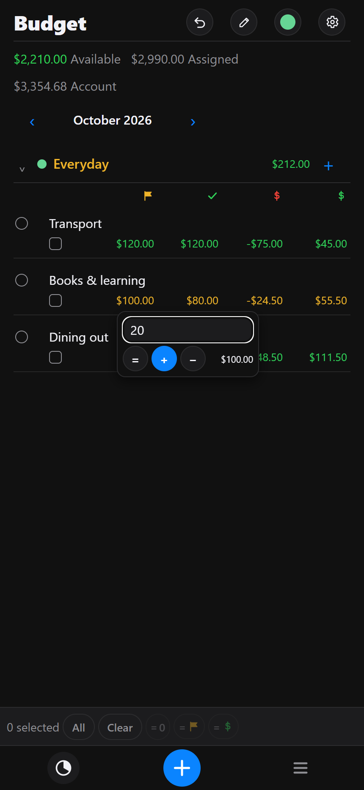
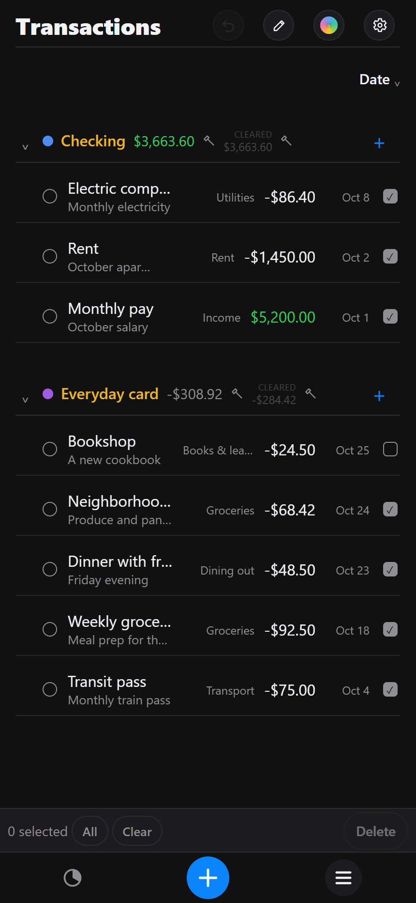
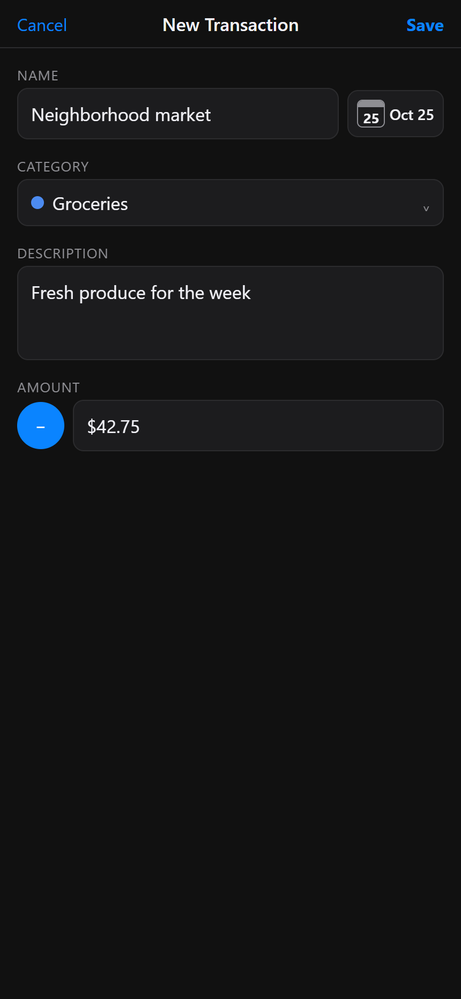

# AcctMind

Feel free to deploy this on your own website, build and deploy the iOS version, etc.

**This is a personal project to have some fun with claude code, which generated essentially all of the code, and the rest of this readme:**

A ledger: transactions by account, and a two-level budget.

- Runs on web, iOS, Android, macOS and Windows. One TypeScript core.
- No server, no database. The device holds the ledger.
- Optional sync: iPhone and iPad over the local network, iPhone and Mac via iCloud Drive.
- Only the web build signs in, with a CalMind account.

## Screens

| Budget | Transactions | Add a transaction |
| --- | --- | --- |
|  |  |  |
| Adjust an allocation and see its target, spent and remaining. | Income and expenses by account, with balances. | Name, date, category, description, amount. |

## Run

```sh
npm install
npm run web          # :8083
npm run test:dev
```

Deploy: copy `deploy.conf.sample` to `deploy.conf`, then `./deploy.sh`. Release: `npm run dtp` (or `tdtp`, tests first); the tag builds Windows and macOS installers on GitHub.

Docs: [ARCHITECTURE](ARCHITECTURE.md) · [TESTING](TESTING.md) · [AGENTS](AGENTS.md). BSD 3-Clause.
